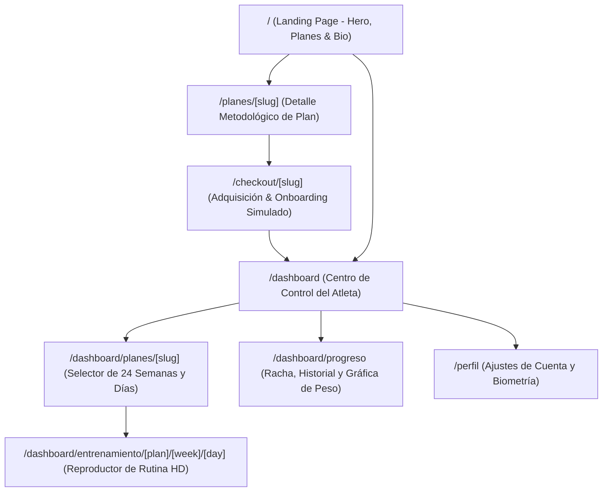

# Estructura del Sistema y Customer Journey // VTeamFit 2026-2027

Estado: Aprobado
Fuente: Extracción forense de producción (https://www.vteamfit.app/), docs/prd.md y docs/extraccion_visual/

---

## 1. Mapa de Pantallas (Sitemap del MVP)

---

## 2. Los 5 Módulos de Planes

| Módulo / Plan | Duración | Semanas / Días | Metodología | Portada |
|---|---|---|---|---|
| **Transforma tu Cuerpo** | 196 días | 28 semanas (6 días/sem) | Hipertrofia y fuerza progresiva | `/fotos/transforma-tu-cuerpo.jpg` |
| **Plan Pádel** | 168 días | 24 semanas (6 días/sem) | Prevención + Fuerza + Velocidad en pista | `/fotos/plan-padel.jpg` |
| **Glúteos de Acero** | 84 días | 12 semanas (5 días/sem) | Aislamiento y biomecánica tren inferior | `/fotos/gluteos.jpg` |
| **Entrena Conmigo** | 30 días | 4 semanas (5 días/sem) | Coaching individualizado 1 a 1 | `/fotos/entrena-conmigo2.webp` |
| **Curso Físico en Pista** | 79 días | 12 semanas (4 días/sem) | Movilidad, frenada y reactividad en pista | `/fotos/fisico-padel.webp` |

---

## 3. Customer Journey del Atleta

### Etapa 1: Descubrimiento & Confianza (Landing Page)
- **Acción:** El usuario visita `https://vteamfit.app/`, ve el Hero inmersivo con Vicky Torres y Tito Allemandi, explora la filosofía de entrenamiento y revisa la grilla de los 5 planes.
- **Punto de contacto:** Header flotante, Hero con textura de carbón, tarjetas con acentos cobre OKLCH, cita testimonial.
- **Dato clave:** Precios transparentes y modalidades claras (mensual, trimestral, pago único).

### Etapa 2: Elección y Alta (Checkout y Onboarding)
- **Acción:** El usuario presiona el plan deseado (ej. *Plan Pádel*), revisa el temario de semanas y confirma la inscripción en el checkout simulado.
- **Punto de contacto:** Formulario limpio de una sola pantalla (nombre, email, password y confirmación de membresía).
- **Resultado:** Redirección inmediata al Dashboard con sesión activa.

### Etapa 3: Ejecución de Sesión (Workout Player)
- **Acción:** El usuario ingresa a su semana actual (ej. Semana 1), selecciona el día (ej. Lunes - `PREVENIR+VELOCIDAD`), inicia el cronómetro y realiza cada ejercicio visualizando el video HD con buffer instantáneo de Bunny CDN.
- **Punto de contacto:** Player con loop de video, cronómetro integrado, campos numéricos de series, repeticiones y kilos utilizados.
- **Validación:** Al presionar `Finalizar Entrenamiento`, califica el RPE (1-10) y el día queda marcado con checkmark verde determinista.

### Etapa 4: Seguimiento y Constancia (Dashboard & Telemetría)
- **Acción:** El usuario consulta su racha de días activos, porcentaje de avance acumulado y registra periódicamente su peso para ver la gráfica de progreso.
